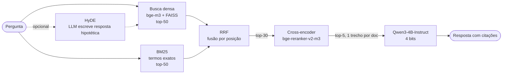
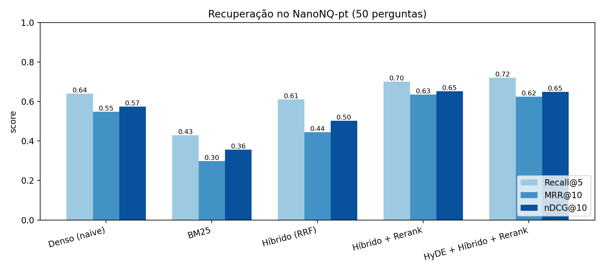
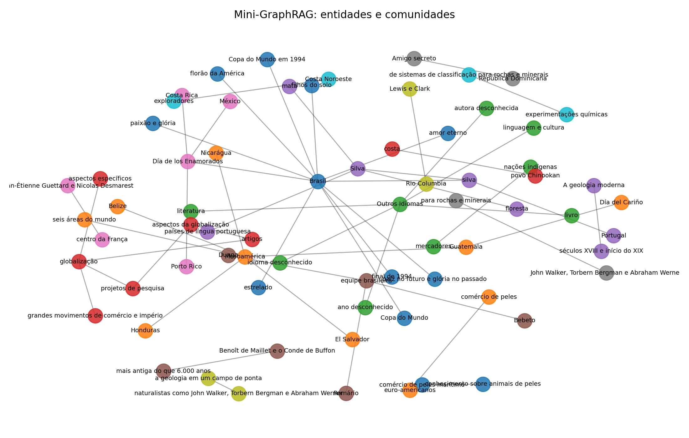

<div align="center">

# 🔎 RAG Avançado com Hugging Face

**Busca híbrida, reranking e HyDE: quanto cada técnica realmente melhora a recuperação em português?**

[](https://www.python.org/)
[](https://huggingface.co/)
[](https://drive.google.com/drive/folders/1r90vmVaAYC0WGnt0sJ-DdDv19ggnzzX7?usp=drive_link)
[](https://huggingface.co/datasets/mariele-vieira/rag-nanonq-pt-index)
[](LICENSE)

Projeto final de **Machine Learning — Deep Learning** · Prof. Claudinei Dias · Católica de Santa Catarina<br>
**Módulo 2: Arquiteturas de Recuperação de Informação (RAG Avançado e GraphRAG)**

**Mariele Vieira · Maria A. Giuliari · Alexandre Sebastian**

</div>

---

## ✨ Em resumo

Um pipeline de *Retrieval-Augmented Generation* construído **só com modelos abertos do Hugging Face Hub**, avaliado
com gabarito em 50 perguntas sobre a Wikipédia em português. Em vez de apenas demonstrar as técnicas de RAG avançado,
o projeto **mede** a contribuição de cada uma.

| | Principais achados |
|---|---|
| 🏆 | **O reranking com cross-encoder foi o maior ganho:** MRR@10 subiu de 0,444 para **0,634** (+43%) sobre a busca híbrida. |
| ⚠️ | **A busca híbrida sozinha piorou** em relação à densa (Recall@5 de 0,64 para 0,61): o BM25 fraco atrapalhou a fusão RRF. |
| 🤏 | **O HyDE quase não mudou nada** (+0,02 de Recall@5, dentro do ruído), mas custa ~9 s de LLM por pergunta. |

## 🧭 Pipeline



| Etapa | Técnica | Modelo / biblioteca |
|---|---|---|
| Indexação | Chunking por frases (800 caracteres, 120 de sobreposição) | `src/rag_core.py` |
| Busca densa | Embeddings multilíngues + índice vetorial (cosseno) | `BAAI/bge-m3` · FAISS |
| Busca léxica | BM25 com remoção de acentos e *stopwords* pt-BR | `rank_bm25` |
| Fusão | Reciprocal Rank Fusion, k = 60 | `src/rag_core.py` |
| Reranking | Cross-encoder nos 30 melhores candidatos | `BAAI/bge-reranker-v2-m3` |
| Query transformation | HyDE (documento hipotético) | `Qwen/Qwen3-4B-Instruct-2507` |
| Geração | Resposta citando `[n]` ou recusa explícita | mesmo LLM, 4 bits (NF4) |
| Extra | Mini-GraphRAG: entidades, relações e comunidades | `networkx` · Louvain |

## 📊 Resultados

Dataset [`hakari-bench/NanoBEIR-pt`](https://huggingface.co/datasets/hakari-bench/NanoBEIR-pt) (subconjunto
**NanoNQ**): 5.035 passagens da Wikipédia em português (6.643 *chunks*), 50 perguntas e o gabarito das passagens
relevantes. Colab com GPU T4.

| Configuração | Recall@5 | MRR@10 | nDCG@10 | ms/consulta¹ |
|---|:---:|:---:|:---:|:---:|
| 1. Denso (naive) | 0.64 | 0.548 | 0.574 | **3.0** |
| 2. BM25 | 0.43 | 0.298 | 0.357 | 7.9 |
| 3. Híbrido (RRF) | 0.61 | 0.444 | 0.502 | 10.8 |
| 4. Híbrido + Rerank | 0.70 | **0.634** | **0.653** | 235.2 |
| 5. HyDE + Híbrido + Rerank | **0.72** | 0.625 | 0.649 | 260.4 |

<p align="center"></p>

¹ Só a **recuperação** (busca densa, BM25, RRF e reranking). Na linha 5, o tempo de **geração do documento
hipotético pelo LLM não está incluído**: no experimento, os 50 documentos levaram 7 min 48 s (≈ 9,4 s por pergunta,
contra ≈ 0,27 s de toda a recuperação).

> [!NOTE]
> Com 50 perguntas, diferenças menores que ~0,03 podem ser ruído (0,02 de Recall@5 equivale a uma pergunta).
> A análise completa, com exemplos qualitativos e limitações, está no [relatório](docs/relatorio.md).

<details>
<summary><b>Mini-GraphRAG</b>: grafo de entidades e comunidades extraído pelo LLM</summary>
<br>
<p align="center"></p>

Demonstração didática com 12 trechos: o LLM extrai triplas (entidade, relação, entidade), o Louvain agrupa as
entidades em comunidades e o LLM resume cada comunidade para responder a uma pergunta **global**.
</details>

## 🖥️ Demo interativa

A interface Gradio permite fazer perguntas, alternar entre RAG naive, híbrido e híbrido + reranking, ligar o HyDE,
ver de qual posição veio cada trecho e comparar **naive × avançado** lado a lado.

1. Abra `Demo_Gradio_Colab.ipynb` na [pasta do Google Drive](https://drive.google.com/drive/folders/1r90vmVaAYC0WGnt0sJ-DdDv19ggnzzX7?usp=drive_link)
   (*Abrir com → Google Colaboratory*).
2. *Ambiente de execução → Alterar o tipo → **T4 GPU***.
3. *Executar tudo* e abra o link `https://….gradio.live` da última célula.

A demo não recalcula nada: ela baixa o índice já publicado no Hub
([`mariele-vieira/rag-nanonq-pt-index`](https://huggingface.co/datasets/mariele-vieira/rag-nanonq-pt-index)) e roda
o LLM em 4 bits na própria GPU do Colab, sem token nem créditos. O link funciona enquanto a sessão estiver ativa.

> [!TIP]
> **Por que Colab e não Hugging Face Spaces?** Spaces com Gradio passaram a exigir o plano PRO, e os créditos
> gratuitos do *Inference Providers* acabam rápido. O app (`space/app.py`) continua compatível com um Space: basta
> enviar o repositório e definir `INDEX_REPO` e `HF_TOKEN`.

## 🗂️ Estrutura

```text
├── notebooks/
│   ├── RAG_Avancado_NanoNQ.ipynb   # experimento completo: indexação, 5 configurações, métricas, GraphRAG
│   └── Demo_Gradio_Colab.ipynb     # sobe a interface Gradio com link público
├── src/rag_core.py                 # funções puras: chunking, BM25, RRF, métricas, prompts
├── space/app.py                    # interface Gradio (usa src/rag_core.py)
├── tests/test_rag_core.py          # testes das funções puras (pytest)
├── results/                        # tabela (JSON) e gráficos gerados pelo notebook
└── docs/
    ├── relatorio.md                # relatório: evolução dos GPTs 2022–2026, estado da arte, experimento
    ├── guia-de-estudo.md           # explicação de cada etapa e perguntas para a apresentação
    └── enunciado-atividade.pdf     # enunciado da disciplina
```

## ▶️ Como executar

**Notebooks:** os dois estão **já executados e com as saídas** na
[pasta do Google Drive](https://drive.google.com/drive/folders/1r90vmVaAYC0WGnt0sJ-DdDv19ggnzzX7?usp=drive_link);
as cópias sem saídas ficam em [`notebooks/`](notebooks/). O experimento roda em ≈ 20–30 min numa T4 e salva
`resultados_rag.png`, `resultados_rag.json` e `graphrag_demo.png`.

**Testes** (só usam a biblioteca padrão):

```bash
pip install pytest
pytest tests/
```

## 📚 Documentação

- 📄 [Relatório](docs/relatorio.md): linha do tempo dos GPTs (2022–2026), estado da arte em RAG, metodologia,
  resultados e discussão.
- 🎓 [Guia de estudo](docs/guia-de-estudo.md): cada etapa do pipeline explicada, com perguntas e respostas para
  a apresentação.

## 📖 Referências principais

- Lewis et al. (2020). *Retrieval-Augmented Generation for Knowledge-Intensive NLP Tasks*.
- Gao et al. (2022). *Precise Zero-Shot Dense Retrieval without Relevance Labels* (HyDE).
- Cormack et al. (2009). *Reciprocal Rank Fusion outperforms Condorcet and individual Rank Learning Methods*.
- Nogueira e Cho (2019). *Passage Re-ranking with BERT*.
- Chen et al. (2024). *BGE M3-Embedding*.
- Edge et al. (2024). *From Local to Global: A Graph RAG Approach to Query-Focused Summarization*.

A lista completa está no [relatório](docs/relatorio.md#referências).

---

<div align="center">Licença <a href="LICENSE">MIT</a></div>
