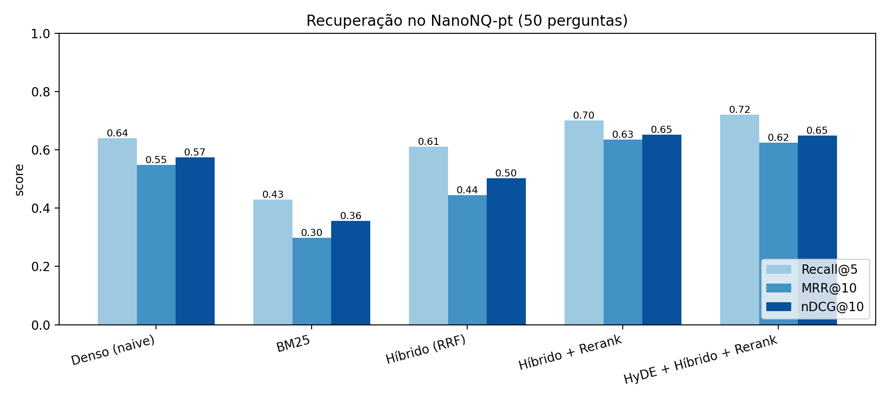
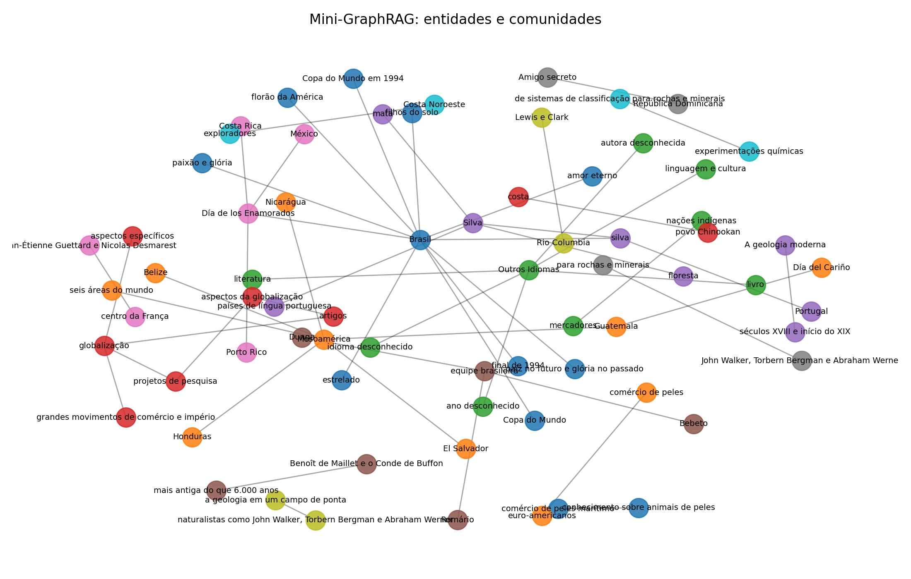

<!-- _paginate: false -->

# RAG Avançado com Hugging Face

## Busca híbrida, reranking e HyDE em português

Machine Learning — Deep Learning · Prof. Claudinei Dias (Ney)
Católica de Santa Catarina · **Módulo 2: RAG Avançado e GraphRAG**

Mariele Vieira

---

## O problema

LLMs sozinhos têm conhecimento **estático** e **não verificável**:

- não sabem nada depois da data de treino
- alucinam com a mesma confiança com que acertam
- não dizem de onde veio a resposta

**RAG** (Lewis et al., 2020): buscar trechos relevantes **antes** de responder, e responder citando as fontes.

---

## Evolução dos GPTs — 2022 e 2023

| Quando | Marco | Impacto em RAG |
|---|---|---|
| 2022 | InstructGPT (RLHF), Chain-of-Thought | modelos **obedecem** ao "use só o contexto" |
| nov/2022 | ChatGPT | demanda por "ChatGPT com meus documentos" |
| dez/2022 | **HyDE** | o LLM melhora a própria **consulta** |
| 2023 | LLaMA, Llama 2, Mistral 7B | ecossistema **aberto** no Hugging Face |
| mai/2023 | QLoRA / NF4 (4 bits) | LLMs de bilhões de parâmetros em GPU gratuita |
| jul/2023 | ***Lost in the Middle*** | **ordem e quantidade** de trechos importam |
| dez/2023 | *Survey* de RAG | Naive → **Advanced** → Modular RAG |

---

## Evolução dos GPTs — 2024 a 2026

| Quando | Marco | Impacto em RAG |
|---|---|---|
| fev/2024 | **BGE-M3**, Gemini 1.5 (1M tokens) | embedding multilíngue aberto; contexto longo não substitui RAG |
| abr/2024 | **GraphRAG** (Microsoft) | perguntas **globais** via grafo + comunidades |
| set/2024 | *Contextual Retrieval*, OpenAI o1 | chunks com contexto; modelos de **raciocínio** |
| nov/2024 | **MCP** | protocolo aberto para ferramentas e dados |
| 2025 | DeepSeek-R1, Qwen3, gpt-oss, *Deep Research* | raciocínio aberto; **RAG agêntico** |
| 2025 | Qwen3-Embedding/Reranker, *Context Rot* | menos contexto e mais relevante continua vencendo |
| 2026 | consolidação | agentes + MCP, multimodal, modelos pequenos |

---

## O gargalo do RAG *naive*

```
pergunta ─► embedding ─► top-k vizinhos ─► LLM
```

1. **Termos exatos**: nomes, números e siglas se "diluem" no embedding
2. **Ruído**: trechos parecidos com a pergunta, mas sem a resposta, ocupam o topo
3. **Lost in the middle**: o LLM ignora o que fica no meio de um contexto longo

➡️ Advanced RAG ataca cada um desses pontos.

---

## Técnicas de Advanced RAG usadas

- **Busca híbrida** — BM25 (termos exatos) + denso (significado), fundidos por **RRF**:
  `score(d) = Σ 1 / (60 + posição)` — só posições, sem calibrar escalas
- **Reranking** — *cross-encoder* lê `[pergunta; trecho]` juntos; preciso, mas caro
  ⇒ reordena só os 30 melhores (*retrieve-then-rerank*)
- **HyDE** — o LLM escreve uma resposta hipotética; buscamos com ela
  (o texto hipotético **nunca** vai para o prompt final)
- **GraphRAG** (demo) — entidades → grafo → comunidades → resumos

---

## Arquitetura

```
           indexação (uma vez)
Corpus HF ─► chunking ─► bge-m3 ─► FAISS (salvo em disco)
                    └──► tokenização ─► BM25

           consulta
Pergunta ─► [HyDE] ─► FAISS top-50 ─┐
        └──────────► BM25  top-50 ─┴─► RRF top-30 ─► reranker ─► top-5 ─► LLM ─► resposta [n]
```

**Tudo aberto, do Hugging Face Hub:** `BAAI/bge-m3` · `BAAI/bge-reranker-v2-m3` ·
`Qwen/Qwen3-4B-Instruct-2507` (4 bits, NF4) · dataset `hakari-bench/NanoBEIR-pt`

---

## Metodologia

- **Dados:** NanoNQ em português — ~5 mil passagens da Wikipédia, 50 perguntas, **com gabarito**
- **5 configurações:** Denso · BM25 · Híbrido · Híbrido + Rerank · HyDE + Híbrido + Rerank
- **Métricas:** Recall@k, MRR@10, nDCG@10 (padrão BEIR/MTEB)
- **Ambiente:** Colab T4 · `float16` · LLM em 4 bits · semente 42

<p class="small">Latência = só recuperação. Na configuração HyDE, o tempo de geração do documento hipotético pelo LLM <b>não</b> está incluído.</p>

---

## Resultados

| Configuração | Recall@5 | MRR@10 | nDCG@10 | ms/consulta* |
|---|---|---|---|---|
| 1. Denso (naive) | 0.64 | 0.548 | 0.574 | 3.0 |
| 2. BM25 | 0.43 | 0.298 | 0.357 | 7.9 |
| 3. Híbrido (RRF) | 0.61 | 0.444 | 0.502 | 10.8 |
| 4. Híbrido + Rerank | 0.70 | 0.634 | 0.653 | 235.2 |
| 5. HyDE + Híbrido + Rerank | 0.72 | 0.625 | 0.649 | 260.4 |

<p class="small">* somente recuperação; linha 5 sem o tempo de geração do HyDE.</p>

<!--  -->

---

## Exemplo: pergunta "resgatada"

<!-- ✏️ Copiar da seção 10/11 do notebook -->

❓ *pergunta*

- RAG naive: passagem correta na posição **…**
- Híbrido + Rerank: passagem correta na posição **…**

💬 Resposta com citações: *…* [1]

**Robustez:** pergunta fora da base → *"Não encontrei essa informação nos documentos."*

---

## Mini-GraphRAG

<!--  -->

- O LLM extrai triplas `(entidade, relação, entidade)` de ~12 trechos
- Louvain agrupa as entidades em comunidades; o LLM resume cada uma
- Pergunta **global** respondida a partir dos resumos (*map-reduce*)

<p class="small">Demonstração didática; não faz parte da avaliação quantitativa.</p>

---

## Demo no Hugging Face Spaces

- App Gradio: escolha o pipeline (naive / híbrido / híbrido + rerank) e ative o HyDE
- Aba **Comparar**: naive × avançado lado a lado para a mesma pergunta
- Mostra as fontes, a posição de cada trecho no denso e no BM25 e o tempo de cada etapa
- LLM via *Inference Providers*; índice pré-calculado baixado do Hub

🔗 `huggingface.co/spaces/<usuario>/rag-avancado-pt`

---

## Conclusões

<!-- ✏️ Ajustar aos números -->

- Contexto longo **não** eliminou o RAG: selecionar **pouco e bem** continua decisivo
- Busca híbrida: …
- Reranking: …
- HyDE: depende do conhecimento do LLM — com 4B pode ajudar ou atrapalhar
- **Limitações:** 50 perguntas; corpus traduzido; avaliação só da recuperação

**Próximos passos:** RAGAS para avaliar a resposta · *contextual retrieval* · RAG agêntico com a busca exposta via MCP

---

<!-- _paginate: false -->

# Obrigada!

Código, notebook e relatório: `github.com/MarieleV/rag-avancado-hf`

<p class="small">Referências completas em <code>docs/relatorio.md</code></p>
