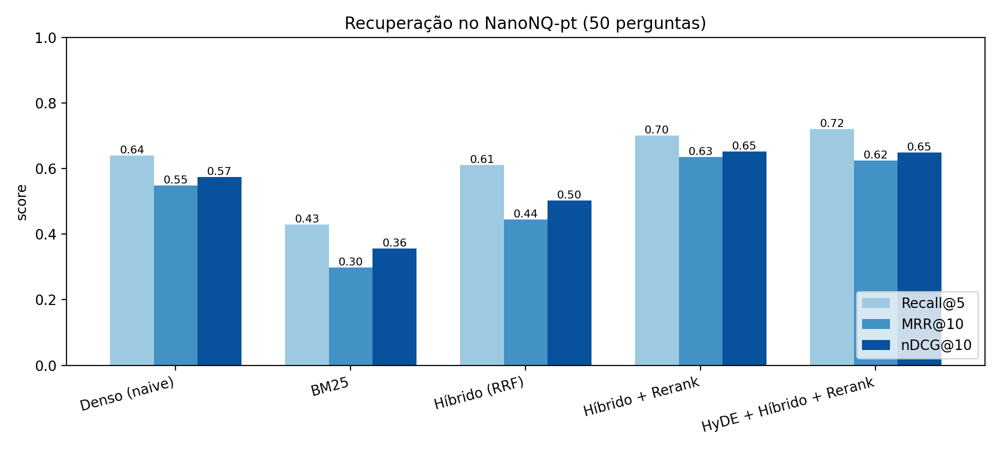
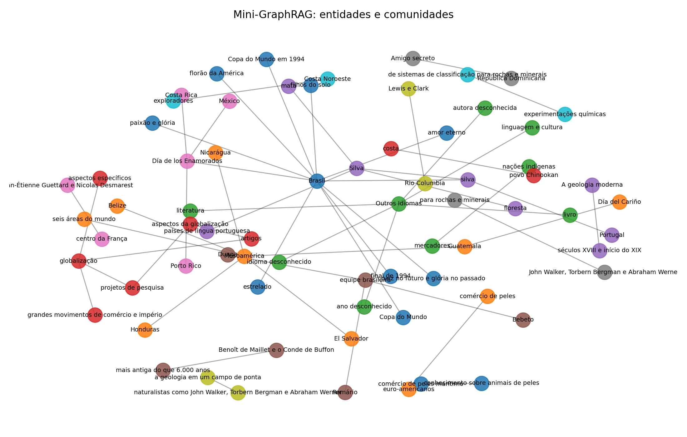

# RAG Avançado com Hugging Face: da evolução dos GPTs (2022–2026) a um pipeline com busca híbrida, reranking e HyDE

**Disciplina:** Machine Learning — Deep Learning · 

**Prof.** Claudinei Dias (Ney) · Católica de Santa Catarina

**Laboratório de Pesquisa — Módulo 2:** Arquiteturas de Recuperação de Informação (RAG Avançado e GraphRAG)

**Alunos:** Mariele Vieira, Maria A. Giuliari e Alexandre Sebastian 

**Código:** repositório `rag-avancado-hf` (notebook, app Gradio no Hugging Face Spaces e testes)

---

## Resumo

Modelos de linguagem do tipo GPT têm conhecimento **estático** (congelado na data de treino) e **não verificável**
(não indicam de onde veio cada afirmação). A Geração Aumentada por Recuperação (*Retrieval-Augmented Generation*,
RAG) ataca os dois problemas: antes de responder, o sistema busca trechos relevantes em uma base de documentos e
o modelo responde apoiado neles, citando as fontes. Este relatório (1) percorre a evolução dos GPTs de 2022 a 2026,
mostrando como cada fase mudou a forma de construir RAG; (2) organiza as técnicas de estado da arte em recuperação;
e (3) descreve um experimento com o ecossistema Hugging Face que **mede com gabarito** quanto cada técnica — busca
híbrida, reranking com *cross-encoder* e transformação de consulta (HyDE) — melhora a recuperação em português,
além de uma demonstração didática de GraphRAG.

---

## 1. Introdução

Um LLM sozinho responde com base no que memorizou durante o pré-treino. Isso gera três limitações práticas:

1. **Desatualização** — fatos posteriores ao corte de treino não existem para o modelo.
2. **Alucinação** — sem evidência, o modelo produz texto plausível mas falso, com a mesma confiança.
3. **Falta de rastreabilidade** — não há como auditar a origem de uma resposta.

Lewis et al. (2020) formalizaram o RAG como a combinação de uma memória **paramétrica** (os pesos do modelo) com
uma memória **não paramétrica** (um índice de documentos consultado em tempo de inferência). A partir de 2023, com a
popularização dos LLMs conversacionais, RAG tornou-se o padrão de mercado para conectar modelos a dados próprios — e
também ficou claro que a versão mais simples (*naive RAG*) tem gargalos sérios, o que motivou as técnicas
"avançadas" estudadas aqui.

**Objetivo do trabalho:** construir um pipeline de RAG apenas com modelos abertos do Hugging Face Hub e quantificar,
em um benchmark com gabarito, a contribuição de cada técnica avançada.

---

## 2. Linha do tempo: a evolução dos GPTs de 2022 a 2026

A tabela resume os marcos; as subseções explicam o que cada fase significou **para RAG**.

| Período | Marco | Por que importa para RAG |
|---|---|---|
| jan/2022 | *Chain-of-Thought prompting* (Wei et al.) | Raciocínio passo a passo via prompt; base para decompor perguntas complexas. |
| mar/2022 | InstructGPT / RLHF (Ouyang et al.) | Modelos passam a **seguir instruções** — essencial para "responda só com o contexto". |
| mar/2022 | Chinchilla (Hoffmann et al.) | Leis de escala ótimas: modelos menores e mais bem treinados ficam competitivos. |
| nov/2022 | ChatGPT (GPT-3.5) | LLMs chegam ao grande público; explode a demanda por "ChatGPT com meus documentos". |
| dez/2022 | HyDE (Gao et al.) | Usa o próprio LLM para melhorar a **consulta** de busca — técnica usada neste projeto. |
| fev/2023 | LLaMA (Meta) | Primeiros pesos abertos competitivos; nasce o ecossistema *open-source* de LLMs. |
| mar/2023 | GPT-4 | Salto de qualidade; contexto de 8K–32K tokens. |
| mai/2023 | QLoRA / NF4 (Dettmers et al.) | Quantização em 4 bits com `bitsandbytes`: LLMs de bilhões de parâmetros em GPUs comuns. |
| jun/2023 | *Function calling* em APIs | O LLM passa a acionar ferramentas — inclusive a própria busca. |
| jul/2023 | Llama 2 · *Lost in the Middle* (Liu et al.) | Pesos abertos com uso comercial; e a evidência de que LLMs **ignoram informação no meio** de contextos longos. |
| set/2023 | Mistral 7B · RAGAS | Modelos pequenos e eficientes (Apache 2.0); métricas para avaliar RAG. |
| out/2023 | Self-RAG (Asai et al.) | O modelo decide **quando** buscar e critica a própria resposta. |
| dez/2023 | Mixtral 8x7B · *survey* de RAG (Gao, Y. et al.) | *Mixture-of-Experts* aberto; taxonomia **Naive → Advanced → Modular RAG**. |
| jan/2024 | Corrective RAG (Yan et al.) | Avalia a qualidade do que foi recuperado e corrige a busca quando é ruim. |
| fev/2024 | BGE-M3 (Chen et al.) · Gemini 1.5 | Embedding multilíngue (100+ idiomas, 8K tokens); contexto de 1M tokens. |
| abr/2024 | GraphRAG (Edge et al., Microsoft) · Llama 3 | Grafos de conhecimento + comunidades para perguntas **globais**. |
| jul/2024 | Llama 3.1 · ColPali | Modelo aberto de 405B com 128K de contexto; recuperação direto sobre a **imagem** das páginas. |
| set/2024 | *Contextual Retrieval* (Anthropic) · OpenAI o1 · Qwen2.5 | Chunks enriquecidos com contexto do documento; início dos **modelos de raciocínio**. |
| out/2024 | LightRAG | GraphRAG mais leve e incremental. |
| nov/2024 | *Model Context Protocol* (MCP) | Protocolo aberto para conectar LLMs a dados e ferramentas. |
| jan/2025 | DeepSeek-R1 · *survey* de RAG agêntico | Raciocínio por RL com pesos abertos; RAG vira um **agente** que planeja buscas. |
| fev–mar/2025 | *Deep Research* · Search-R1 · Gemma 3 | Agentes que fazem dezenas de buscas encadeadas; modelos treinados por RL para buscar. |
| abr/2025 | Qwen3 · Llama 4 | Modelos abertos híbridos (com/sem "pensamento") e MoE. |
| jun–jul/2025 | Qwen3-Embedding/Reranker · Qwen3-2507 · *Context Rot* | Embeddings/rerankers abertos de ponta; versão Instruct do Qwen3 com 256K de contexto (usada aqui); evidência de que o desempenho **cai com contextos muito longos**. |
| ago/2025 | GPT-5 · gpt-oss (OpenAI, pesos abertos) | Roteamento entre modo rápido e de raciocínio; OpenAI volta a publicar pesos abertos. |
| set/2025 | EmbeddingGemma | Embeddings multilíngues pequenos para rodar no dispositivo. |
| nov/2025 | Gemini 3 | Nova geração de modelos multimodais de raciocínio. |
| dez/2025 | MCP vai para a Linux Foundation | Padrão aberto e neutro para agentes acessarem ferramentas e dados. |
| 2026 | Consolidação (ver 2.5) | Agentes, raciocínio como padrão, recuperação multimodal e avaliação contínua. |

### 2.1 2022 — Alinhamento e o "momento ChatGPT"

A arquitetura de base já existia (Transformer *decoder-only*, GPT-3 em 2020). O avanço de 2022 foi de **alinhamento**:
o InstructGPT mostrou que ajuste fino supervisionado seguido de RLHF faz um modelo de 1,3B ser preferido a um GPT-3
de 175B sem ajuste. Isso é o que permite, hoje, escrever um *system prompt* como "use **apenas** os trechos
fornecidos e cite as fontes" e esperar obediência. No fim do ano, o ChatGPT tornou a tecnologia popular e, quase ao
mesmo tempo, o HyDE mostrou um uso novo para o LLM: **gerar um documento hipotético** para melhorar a busca, sem
nenhum dado rotulado.

### 2.2 2023 — Modelos abertos e o RAG como padrão de mercado

LLaMA, Llama 2 e Mistral 7B criaram um ecossistema aberto no Hugging Face Hub, e a quantização em 4 bits
(QLoRA/NF4) permitiu rodar esses modelos em GPUs gratuitas. RAG virou a arquitetura padrão para "conversar com
documentos", e seus problemas ficaram evidentes:

- **Recuperação ruim** — a busca vetorial pura erra nomes próprios, números e siglas.
- **Ruído no contexto** — trechos parecidos com a pergunta, mas sem a resposta, distraem o modelo.
- ***Lost in the middle*** — Liu et al. mostraram que a acurácia cai quando a informação certa está no meio de um
  contexto longo: **ordem e quantidade** de trechos importam.

O *survey* de Gao, Y. et al. (2023) organizou as respostas a esses problemas na taxonomia **Naive RAG → Advanced RAG
→ Modular RAG**, que estrutura a seção 3 e o experimento deste trabalho. No mesmo ano surgiram as primeiras ideias de
RAG adaptativo (Self-RAG) e métricas específicas de avaliação (RAGAS).

### 2.3 2024 — Contexto longo, embeddings multilíngues e GraphRAG

Janelas de contexto chegaram a 128K (Llama 3.1) e 1M de tokens (Gemini 1.5), o que levantou a pergunta
"contexto longo vai substituir o RAG?". A resposta prática foi **não**: colocar uma base inteira no prompt é caro,
lento e sofre com distração; RAG continua necessário para bases grandes, dinâmicas ou que exigem citação.
Ao mesmo tempo, a recuperação evoluiu:

- **Embeddings multilíngues fortes e abertos** — o BGE-M3 (usado neste projeto) atende português com qualidade.
- **Rerankers multilíngues** — `bge-reranker-v2-m3` (também usado aqui).
- **GraphRAG** — para perguntas *globais* ("quais os temas principais?"), cuja resposta não está em nenhum trecho
  isolado, a Microsoft propôs extrair um grafo de entidades, agrupá-las em comunidades e resumir cada comunidade.
- ***Contextual Retrieval*** — antes de indexar, cada chunk recebe uma frase gerada pelo LLM situando-o no
  documento, combinada com BM25 e reranking.
- **Modelos de raciocínio** (o1) e o **MCP** abriram caminho para a fase seguinte.

### 2.4 2025 — Raciocínio aberto e RAG agêntico

O DeepSeek-R1 mostrou que o raciocínio em cadeia pode ser aprendido por reforço e publicado com pesos abertos;
Qwen3, Llama 4 e gpt-oss seguiram com modelos abertos, vários em arquitetura MoE. Para RAG, a mudança central foi
de **pipeline fixo** para **agente**: em vez de "buscar uma vez e responder", o modelo planeja, busca, avalia o que
encontrou e busca de novo (*Deep Research*, Search-R1, RAG agêntico). Os modelos de recuperação também melhoraram
(família Qwen3-Embedding/Reranker, EmbeddingGemma), e estudos como *Context Rot* confirmaram que, mesmo com janelas
enormes, **entregar menos texto e mais relevante** continua dando respostas melhores — o argumento central para
reranking.

### 2.5 2026 — Tendências de consolidação

Até a data deste relatório, a evolução de 2026 é menos de uma nova arquitetura e mais de **consolidação** das
linhas abertas em 2024–2025:

- **Raciocínio como padrão** — modelos que alternam entre resposta rápida e raciocínio estendido conforme a
  dificuldade, inclusive em versões abertas pequenas.
- **Agentes conectados por protocolos abertos** — o MCP se firmou como forma padrão de expor bases de dados,
  buscas e APIs a modelos; a "busca" passa a ser uma ferramenta entre outras.
- **Recuperação multimodal e de documentos visuais** — tabelas, PDFs e imagens indexados diretamente.
- **Modelos pequenos e eficientes** — MoE e quantização tornam viável rodar o pipeline inteiro localmente.
- **Avaliação contínua** — benchmarks com gabarito e métricas de fidelidade da resposta deixam de ser opcionais.

Mesmo nesse cenário agêntico, o núcleo do sistema continua sendo o mesmo deste trabalho: **uma boa função de
recuperação** (híbrida + reranking). Um agente que busca mal só erra mais vezes.

---

## 3. Estado da arte em RAG

### 3.1 Naive RAG

Indexação (dividir documentos em *chunks* → gerar embeddings → guardar em um banco vetorial) e consulta (embedding
da pergunta → *k* vizinhos mais próximos → prompt → LLM). É simples, mas herda todos os problemas da seção 2.2.

### 3.2 Advanced RAG — técnicas por etapa

| Etapa | Técnica | Ideia | Neste projeto |
|---|---|---|---|
| Indexação | *Chunking* por frases com sobreposição | Não cortar a informação na fronteira entre pedaços | ✅ 800 caracteres, 120 de sobreposição |
| Indexação | *Contextual retrieval* / *late chunking* | Dar a cada chunk o contexto do documento | Trabalho futuro |
| Pré-recuperação | **Query transformation** (HyDE, reescrita, decomposição) | Aproximar a consulta da "forma" de um documento | ✅ HyDE |
| Recuperação | **Busca híbrida** (BM25 + denso) | Léxico acerta termos exatos; denso acerta significado | ✅ fusão por RRF |
| Recuperação | *Late interaction* (ColBERT, ColPali) | Comparar token a token, mais preciso que um vetor só | Fora do escopo |
| Pós-recuperação | **Reranking com cross-encoder** | Ler pergunta e trecho juntos e reordenar | ✅ `bge-reranker-v2-m3` |
| Pós-recuperação | Diversificação / compressão | Evitar trechos redundantes e encurtar o contexto | ✅ um chunk por documento |
| Geração | Prompt com citações e recusa | Respostas verificáveis; "não sei" quando não há evidência | ✅ |

**Busca híbrida e RRF.** BM25 (Robertson e Zaragoza, 2009) pontua pela frequência dos termos exatos; a busca densa
compara significados. Como os scores dos dois têm escalas incompatíveis, a *Reciprocal Rank Fusion*
(Cormack et al., 2009) combina **apenas as posições**: `score(d) = Σ 1 / (60 + posição de d em cada lista)`.

**Bi-encoder × cross-encoder.** O modelo de embedding (*bi-encoder*) codifica pergunta e documento
**separadamente**, o que permite pré-calcular o índice, mas impede que os dois textos "conversem". O *cross-encoder*
processa `[pergunta; trecho]` juntos, com atenção entre todos os tokens: é muito mais preciso e muito mais caro.
Por isso o padrão é ***retrieve-then-rerank*** (Nogueira e Cho, 2019): o bi-encoder traz dezenas de candidatos e o
cross-encoder reordena só esses.

**HyDE.** Perguntas são curtas e interrogativas; documentos são longos e afirmativos. O HyDE pede ao LLM um
parágrafo que *responderia* a pergunta — mesmo com erros factuais — e busca com o embedding desse texto, que fica
mais próximo dos documentos reais no espaço vetorial. O texto hipotético **nunca** vai para o prompt final.

### 3.3 GraphRAG

O RAG por chunks responde bem a perguntas **locais** ("quem escreveu X?") e mal a perguntas **globais** ("quais os
temas principais da base?"). O GraphRAG (Edge et al., 2024) (1) usa o LLM para extrair entidades e relações de cada
trecho; (2) agrupa as entidades em comunidades (Leiden/Louvain); (3) resume cada comunidade; e (4) responde perguntas
globais combinando esses resumos (*map-reduce*). O custo é alto (muitas chamadas ao LLM na indexação), o que
motivou variantes mais leves como o LightRAG. O notebook traz uma versão em miniatura com `networkx` e Louvain.

### 3.4 Modular e agêntico

O RAG modular trata cada etapa como um componente trocável e permite fluxos condicionais (buscar ou não, buscar de
novo, mudar de fonte). Self-RAG, Corrective RAG e os agentes de 2025 são instâncias disso. Esses sistemas
**dependem** de uma recuperação de base de qualidade — que é exatamente o que este trabalho mede.

### 3.5 Avaliação

- **Recuperação** (precisa de gabarito/*qrels*): Recall@k, MRR, nDCG — métricas do BEIR (Thakur et al., 2021) e do MTEB.
- **Geração**: fidelidade ao contexto (*faithfulness*), relevância da resposta e precisão do contexto (RAGAS).

---

## 4. Do estado da arte ao projeto: decisões e justificativas

| Decisão | Escolha | Justificativa (seção) |
|---|---|---|
| Dados | `hakari-bench/NanoBEIR-pt` / NanoNQ | Wikipédia em português **com gabarito**: permite medir, não só demonstrar (3.5) |
| Embedding | `BAAI/bge-m3` | Multilíngue, aberto, forte em português (2.3) |
| Banco vetorial | FAISS `IndexFlatIP`, salvo em disco | Busca exata; vetores normalizados ⇒ cosseno |
| Busca léxica | BM25 com remoção de acentos e *stopwords* pt-BR | Corrige a fraqueza do denso em nomes e números (3.2) |
| Fusão | RRF, k = 60 | Dispensa calibrar escalas de score (3.2) |
| Reranking | `BAAI/bge-reranker-v2-m3` nos 30 melhores | *Retrieve-then-rerank*; menos ruído no contexto (2.2, 2.4) |
| Query transformation | HyDE | Técnica sem rótulos que usa o próprio LLM (2.1) |
| Contexto do LLM | 5 trechos, um por documento | *Lost in the middle* e *Context Rot*: menos e melhor (2.2, 2.4) |
| LLM gerador | `Qwen/Qwen3-4B-Instruct-2507` em 4 bits (NF4) | Aberto (Apache 2.0), bom em português, cabe numa T4 gratuita (2.2, 2.4) |
| Prompt | Citações `[n]` + frase fixa de recusa | Rastreabilidade e redução de alucinação |
| GraphRAG | Mini-demonstração | Ilustrar perguntas globais sem o custo de indexar o corpus todo (3.3) |
| Interface | Gradio no Hugging Face Spaces + Inference Providers | Prototipagem pública com modelos do Hub |

---

## 5. Metodologia

**Dados.** Subconjunto NanoNQ do NanoBEIR traduzido para português: ~5 mil passagens da Wikipédia, 50 perguntas
reais (*Natural Questions*, Kwiatkowski et al., 2019) e o gabarito das passagens relevantes.

**Indexação.** Cada documento é dividido em chunks de até 800 caracteres (respeitando fim de frase, 120 caracteres de
sobreposição); cada chunk guarda o `doc_id` de origem. São construídos dois índices: FAISS (denso, salvo em
`indice_local/index.faiss`) e BM25 (léxico).

**Configurações comparadas.**

| # | Configuração | Pipeline |
|---|---|---|
| 1 | Denso (naive) | bge-m3 → FAISS top-50 |
| 2 | BM25 | BM25 top-50 |
| 3 | Híbrido | BM25 top-50 + denso top-50 → RRF |
| 4 | Híbrido + Rerank | (3) → cross-encoder nos 30 melhores |
| 5 | HyDE + Híbrido + Rerank | denso com `pergunta + documento hipotético` + BM25 com a pergunta → RRF → cross-encoder |

**Métricas.** Calculadas no nível de **documento** (o ranking de chunks é convertido mantendo a primeira aparição de
cada documento): Recall@{1, 3, 5, 10}, MRR@10 e nDCG@10.

**Latência.** Tempo médio de **recuperação** por pergunta (busca densa, BM25, RRF e reranking).
**Importante:** na configuração 5, a latência reportada **não inclui o tempo de geração do documento hipotético
pelo LLM**, que é uma chamada adicional ao modelo por pergunta e, em geral, custa mais do que todas as etapas de
recuperação somadas. O custo real do HyDE é, portanto, maior do que o mostrado na tabela; o tempo total da etapa
aparece na saída `%%time` da seção 9 do notebook.

**Ambiente.** Google Colab com GPU T4; embeddings e reranker em `float16`; LLM quantizado em 4 bits (NF4) com
`bitsandbytes`; decodificação gulosa (`do_sample=False`); semente 42.

---

## 6. Resultados

**Corpus e índice.** 5.035 documentos foram divididos em 6.643 chunks (1,32 por documento); o índice FAISS tem 1.024 dimensões e 27,2 MB em disco. As 50 perguntas têm 57 pares relevantes (algumas têm mais de uma passagem correta). 

| Configuração | Recall@5 | MRR@10 | nDCG@10 | ms/consulta¹ |
|---|---|---|---|---|
| 1. Denso (naive) | 0.640 | 0.548 | 0.574 | 2.9 |
| 2. BM25 | 0.430 | 0.298 | 0.356 | 6.8 |
| 3. Híbrido (RRF) | 0.610 | 0.444 | 0.502 | 9.7 |
| 4. Híbrido + Rerank | 0.700 | 0.634 | 0.652 | 271.4 |
| 5. HyDE + Híbrido + Rerank | 0.720 | 0.625 | 0.649 | 269.2 |

¹ Somente recuperação. Na linha 5, **sem** o tempo de geração do HyDE pelo LLM (ver seção 5).
A busca densa roda em lote para as 50 perguntas, então a latência por consulta das linhas 1, 3, 4 e 5 está um pouco subestimada em relação a um uso consulta a consulta.

<!--  -->

**Leitura da tabela:** O Recall@k completo (k = 1, 3, 5, 10) está em ´results/resultados_rag.json´. Para o Recall@1, os valores foram 0,39 (denso), 0,18 (BM25), 0,30 (híbrido), 0,49 (híbrido + rerank) e 0,48 (HyDE); para o Recall@10, 0,73, 0,55, 0,69, 0,78 e 0,78.

**Exemplos qualitativos** (seção 11 do notebook): Em 15 das 50 perguntas o RAG naive não trouxe a passagem correta no top-5; o pipeline com reranking resgatou 5 delas (a posição é calculada no nível de documento):

| Pergunta | Posição no naive | Posição com rerank | 
|---|---|---|---|---|
| Por que existe o Anjo do Norte? | 9 | 4 | 
| Quais foram os resultados do desenvolvimento ferroviário na Flórida? | 15 | 3 | 
| Estou disposto a dar a vida para defender o seu direito de dizê-lo. | 8 | 1 | 

Na comparação lado a lado com apenas 3 trechos no contexto, a passagem correta entrou no contexto do pipeline avançado nas perguntas da Flórida e da frase atribuída a Voltaire, e não entrou no naive. Na última, o naive respondeu "Não encontrei essa informação nos documentos", enquanto o avançado explicou, citando a fonte [1], que a frase é uma versão adaptada de uma frase de Hall, frequentemente atribuída a Voltaire. Na pergunta do Anjo do Norte a passagem correta ficou na posição 4, fora do contexto de 3 trechos nos dois pipelines; o naive recusou, mas o avançado respondeu com base em trechos sobre outro assunto, o que mostra que a recusa não é garantida.

**Teste de robustez:** para "Qual foi o placar da final da Copa do Mundo de 2026?" (fora da base), o contexto trouxe passagens sobre outras Copas e o modelo respondeu corretamente "Não encontrei essa informação nos documentos."

**GraphRAG (demonstração)** (seção 12): A partir de 12 trechos recuperados para "história e geografia do Brasil", o LLM extraiu um grafo com **71 entidades e 54 relações**. As quatro maiores comunidades (Louvain) tinham 10, 8, 7 e 6 entidades. Apenas a primeira tratava do Brasil (identidade nacional e futebol); as demais giraram em torno de América Central e Mesoamérica, de um grupo sem tema claro e de globalização. A resposta à pergunta global ("quais os principais temas dos documentos sobre o Brasil?") acabou usando só a primeira comunidade. O resultado ilustra o mecanismo, mas com limites claros: o corpus é um conjunto de passagens da Wikipédia sem tema comum, e o grafo é esparso (54 relações para 71 entidades), o que gera comunidades pequenas e pouco coerentes.
<!--  -->

---

## 7. Discussão

- **Híbrido × denso:** A fusão **não melhorou** a recuperação: Recall@5 foi de 0,64 para 0,61, MRR@10 de 0,548 para 0,444 e nDCG@10 de 0,574 para 0,502. O BM25 sozinho ficou bem abaixo do denso (Recall@5 = 0,43; nDCG@10 = 0,356) e, como o RRF dá o mesmo peso às duas listas, ele rebaixou acertos do denso (Recall@1 caiu de 0,39 para 0,30). Uma explicação plausível, que não testamos, é que as perguntas do Natural Questions são paráfrases em linguagem natural e o corpus é uma tradução automática: o vocabulário da pergunta e o da passagem divergem (por exemplo, "O Estranho Mundo de Jack" na pergunta contra "O Pesadelo Antes do Natal" na passagem correta), o que enfraquece a busca por termos exatos. Não analisamos pergunta a pergunta onde o BM25 ajudou, e não testamos pesos diferentes no RRF.
- **Ganho do reranking:** É o maior ganho do trabalho. Do híbrido para o híbrido + rerank: Recall@5 de 0,61 para 0,70, MRR@10 de 0,444 para 0,634, nDCG@10 de 0,502 para 0,652 e Recall@1 de 0,30 para 0,49. Em relação ao naive: +0,06 no Recall@5, +0,086 no MRR@10 e +0,078 no nDCG@10. O reranking atua sobretudo na **ordem** (passagem certa mais perto do topo), o que importa para um contexto de 5 trechos. Ele só reordena os 30 candidatos do híbrido, então tem um teto: o Recall@10 parou em 0,78. Como não testamos "denso + rerank" (sem BM25), não dá para separar quanto do ganho vem do reranker e quanto do conjunto de candidatos.
- **HyDE:** Sem ganho mensurável: Recall@5 foi de 0,70 para 0,72 (≈ uma pergunta a mais em 50), enquanto Recall@1 (0,49 → 0,48), MRR@10 (0,634 → 0,625) e nDCG@10 (0,652 → 0,649) ficaram praticamente iguais e o Recall@10 não mudou. Todas as diferenças são ≤ 0,02, abaixo da margem de ruído (~0,03). Isso é coerente com a hipótese de que o HyDE depende do conhecimento do LLM: no primeiro exemplo, o modelo de 4B afirmou que "O Estranho Mundo de Jack" não é um filme da Disney e inventou uma explicação, o tipo de fato errado que pode afastar a busca da resposta. Resultado neutro é um achado válido.
- **Custo × benefício:** O reranking acrescentou ≈ 262 ms por consulta (271,4 − 9,7 ms) na T4, para 30 pares. O HyDE exige uma chamada ao LLM por pergunta: gerar os 50 documentos hipotéticos levou 7 min 48 s (≈ 9,4 s por pergunta, mais de 30 vezes o tempo de toda a recuperação), sem benefício claro. Neste experimento, a melhor relação custo-benefício foi a configuração 4 (híbrido + rerank).

**Limitações:** 50 perguntas é uma amostra pequena (diferenças menores que ~0,03 podem ser ruído; 0,02 de Recall@5 equivale a uma pergunta); o corpus é uma tradução automática; a avaliação quantitativa cobre a recuperação, não a qualidade da resposta gerada (os exemplos qualitativos mostram que o LLM pode responder mesmo quando o contexto não tem a resposta); a busca densa foi medida em lote; o GraphRAG é uma demonstração com 12 trechos, não uma avaliação; e não rodamos a ablação "denso + rerank" nem variações de peso no RRF.

---

## 8. Conclusão

A evolução de 2022 a 2026 levou os GPTs de modelos que apenas completam texto a agentes que raciocinam e usam
ferramentas. Nesse percurso, contexto mais longo não eliminou a necessidade de recuperação: evidências como
*lost in the middle* e *context rot* mostram que **selecionar pouco e bem** continua sendo decisivo. As técnicas de
Advanced RAG — busca híbrida, reranking com cross-encoder e transformação de consulta — atacam exatamente esse ponto,
e este trabalho as implementa apenas com componentes abertos do Hugging Face, medindo a contribuição de cada uma em
português.

**Trabalhos futuros:** avaliar a resposta gerada com RAGAS (*faithfulness*, *answer relevancy*); testar
*contextual retrieval*; comparar com a família Qwen3-Embedding/Reranker; GraphRAG completo sobre o corpus; e
transformar o pipeline em um agente que decide quando e o que buscar, expondo a busca via MCP.

---

## Referências

- Asai, A. et al. (2023). *Self-RAG: Learning to Retrieve, Generate, and Critique through Self-Reflection*. arXiv:2310.11511.
- Chen, J. et al. (2024). *BGE M3-Embedding: Multi-Lingual, Multi-Functionality, Multi-Granularity Text Embeddings Through Self-Knowledge Distillation*. arXiv:2402.03216.
- Cormack, G. V.; Clarke, C. L. A.; Büttcher, S. (2009). *Reciprocal Rank Fusion Outperforms Condorcet and Individual Rank Learning Methods*. SIGIR.
- DeepSeek-AI (2025). *DeepSeek-R1: Incentivizing Reasoning Capability in LLMs via Reinforcement Learning*. arXiv:2501.12948.
- Dettmers, T. et al. (2023). *QLoRA: Efficient Finetuning of Quantized LLMs*. arXiv:2305.14314.
- Edge, D. et al. (2024). *From Local to Global: A Graph RAG Approach to Query-Focused Summarization*. arXiv:2404.16130.
- Es, S. et al. (2023). *RAGAS: Automated Evaluation of Retrieval Augmented Generation*. arXiv:2309.15217.
- Faysse, M. et al. (2024). *ColPali: Efficient Document Retrieval with Vision Language Models*. arXiv:2407.01449.
- Gao, L.; Ma, X.; Lin, J.; Callan, J. (2022). *Precise Zero-Shot Dense Retrieval without Relevance Labels* (HyDE). arXiv:2212.10496.
- Gao, Y. et al. (2023). *Retrieval-Augmented Generation for Large Language Models: A Survey*. arXiv:2312.10997.
- Guo, Z. et al. (2024). *LightRAG: Simple and Fast Retrieval-Augmented Generation*. arXiv:2410.05779.
- Hoffmann, J. et al. (2022). *Training Compute-Optimal Large Language Models* (Chinchilla). arXiv:2203.15556.
- Hong, K.; Troynikov, A.; Huber, J. (2025). *Context Rot: How Increasing Input Tokens Impacts LLM Performance*. Chroma Research.
- Jin, B. et al. (2025). *Search-R1: Training LLMs to Reason and Leverage Search Engines with Reinforcement Learning*. arXiv:2503.09516.
- Khattab, O.; Zaharia, M. (2020). *ColBERT: Efficient and Effective Passage Search via Contextualized Late Interaction over BERT*. SIGIR.
- Kwiatkowski, T. et al. (2019). *Natural Questions: A Benchmark for Question Answering Research*. TACL.
- Lewis, P. et al. (2020). *Retrieval-Augmented Generation for Knowledge-Intensive NLP Tasks*. NeurIPS.
- Liu, N. F. et al. (2023). *Lost in the Middle: How Language Models Use Long Contexts*. arXiv:2307.03172 (TACL 2024).
- Muennighoff, N. et al. (2023). *MTEB: Massive Text Embedding Benchmark*. EACL.
- Nogueira, R.; Cho, K. (2019). *Passage Re-ranking with BERT*. arXiv:1901.04085.
- Ouyang, L. et al. (2022). *Training Language Models to Follow Instructions with Human Feedback* (InstructGPT). NeurIPS.
- Qwen Team (2025). *Qwen3 Technical Report*. arXiv:2505.09388.
- Robertson, S.; Zaragoza, H. (2009). *The Probabilistic Relevance Framework: BM25 and Beyond*. Foundations and Trends in IR.
- Singh, A. et al. (2025). *Agentic Retrieval-Augmented Generation: A Survey on Agentic RAG*. arXiv:2501.09136.
- Thakur, N. et al. (2021). *BEIR: A Heterogeneous Benchmark for Zero-shot Evaluation of Information Retrieval Models*. NeurIPS Datasets and Benchmarks.
- Touvron, H. et al. (2023). *LLaMA: Open and Efficient Foundation Language Models*. arXiv:2302.13971.
- Vaswani, A. et al. (2017). *Attention Is All You Need*. NeurIPS.
- Wei, J. et al. (2022). *Chain-of-Thought Prompting Elicits Reasoning in Large Language Models*. NeurIPS.
- Yan, S.-Q. et al. (2024). *Corrective Retrieval Augmented Generation*. arXiv:2401.15884.
- Zhang, Y. et al. (2025). *Qwen3 Embedding: Advancing Text Embedding and Reranking Through Foundation Models*. arXiv:2506.05176.
- Anthropic (2024). *Introducing Contextual Retrieval* (blog, set/2024) e *Introducing the Model Context Protocol* (blog, nov/2024).
